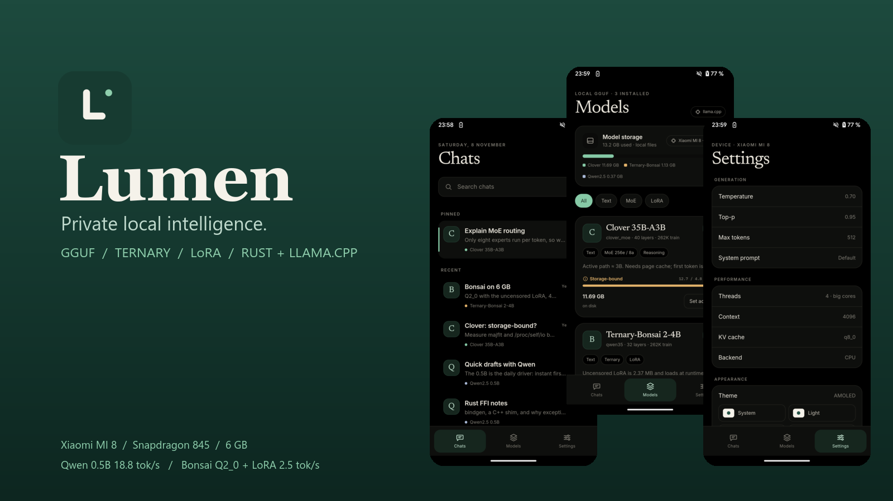
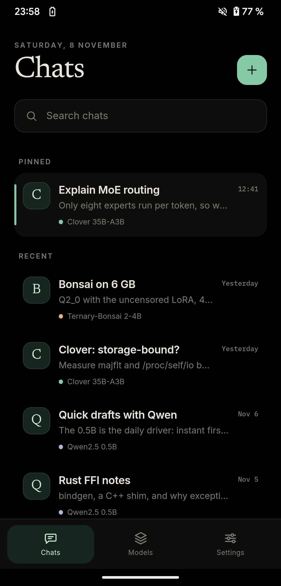
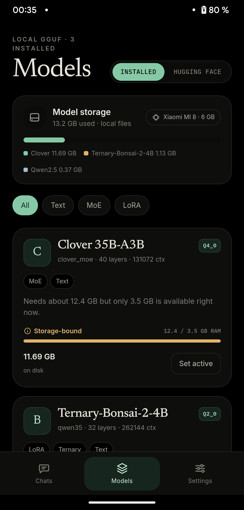
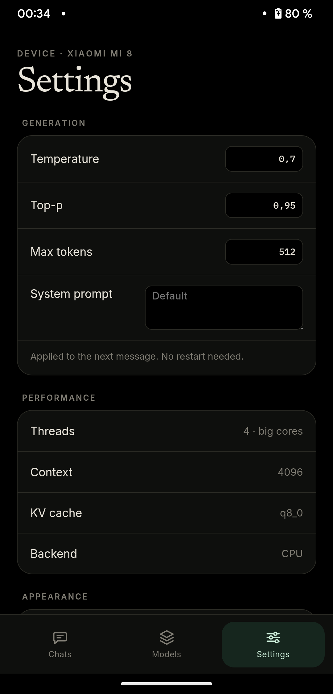
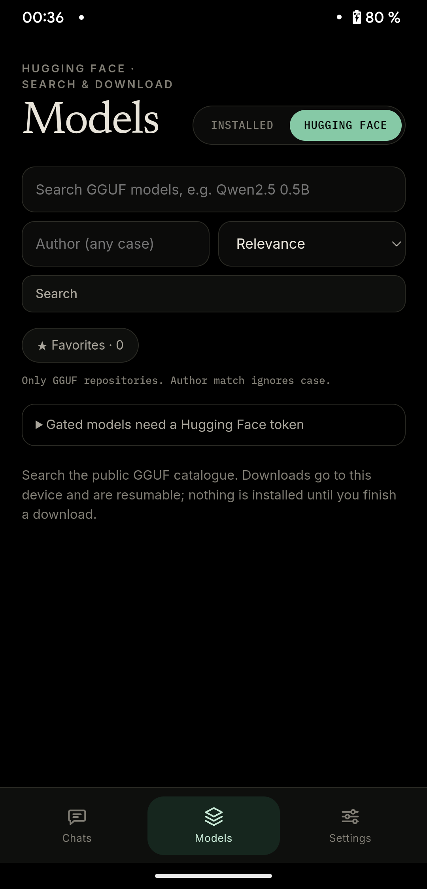
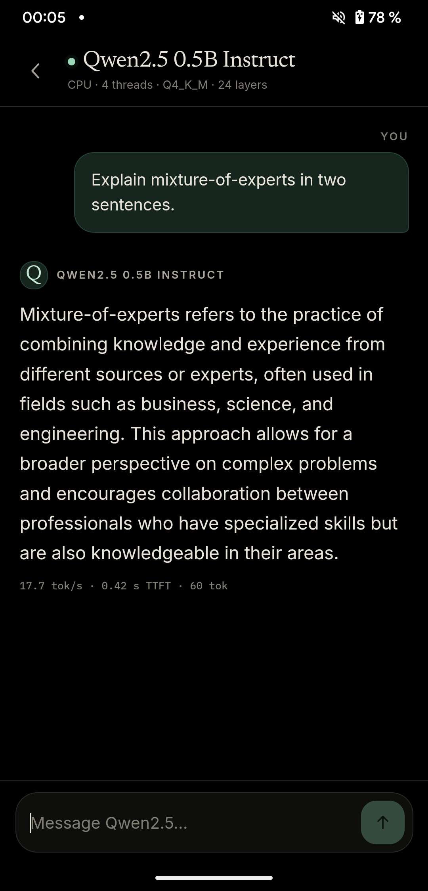
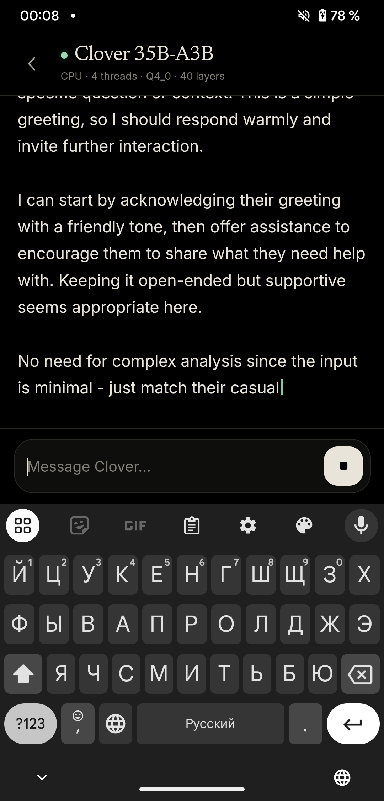
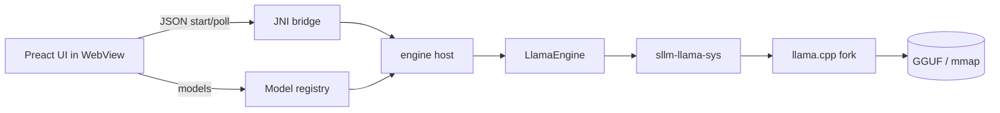

<div align="center">



# Lumen

**Private local intelligence for Snapdragon.**

A Rust-native Android runtime for open GGUF models: dense, MoE and ternary.
Real llama.cpp inference, streaming chat, runtime LoRA, and a calm editorial UI.
No cloud. No account. No telemetry.

[](https://www.rust-lang.org/)
[](https://www.android.com/)
[](https://github.com/ggml-org/llama.cpp/pull/31306)
[](LICENSE-MIT)
[](https://github.com/RandoTeam/lumen/releases)

[Download beta](https://github.com/RandoTeam/lumen/releases) · [Screenshots](#screenshots) · [Watch the 21 s film](docs/brand/lumen-beta.mp4) · [Build](#build-from-source) · [Roadmap](#roadmap) · [Honest status](#honest-status)

</div>

---

## Why Lumen

Most “local LLM” Android apps are a chat box on top of a cloud API, or a demo
that never loads a model. Lumen is the opposite: the model file is the product.
It runs on the phone, survives without a network, and tells you the truth about
memory, quantisation and speed.

- **Rust core, thin Java shell.** Model loading, tokenisation, sampling,
  cancellation and memory trimming live in Rust. Java only owns the Activity and
  the WebView.
- **Real llama.cpp.** The pinned fork includes `clover_moe`, ternary kernels and
  runtime LoRA. `engine()` returns `"llama"`, not `"mock"`.
- **Streaming that can be stopped.** Tokens arrive through a Rust worker queue;
  `Stop` cancels decoding in milliseconds.
- **Honest memory model.** Dense, MoE and ternary models get different estimates.
  MoE is storage-bound, not “fits in 6 GB”.
- **Paper & Ink UI.** Newsreader, Inter and Plex Mono; light, dark, night and
  AMOLED themes; reduced motion; no glassmorphism.

> Formerly **SnapdragonLLM**. The old Kotlin/Compose prototype lives in a local
> archive and is not part of this repository.

## Screenshots

<div align="center">

| Chats | Models | Settings |
| :---: | :---: | :---: |
|  |  |  |

Hugging Face browser, built into the same Models screen:

<div align="center">

</div>

</div>

Real generation on a Xiaomi MI 8 (Snapdragon 845, 6 GB):

<div align="center">


</div>

Left: Qwen 0.5B, 18.8 tok/s. Right: Clover 35B-A3B, 0.7 tok/s on the same
Snapdragon 845 with 6 GB RAM.

## What works today

| Area | Status | Notes |
| --- | :---: | --- |
| Rust workspace | ✅ | `sllm-core`, `sllm-model`, `sllm-engine`, `sllm-llama-sys`, `sllm-webapp` |
| GGUF preflight | ✅ | arch, quant, layers, context, MoE, ternary, LoRA, mmproj, split shards |
| llama.cpp CPU backend | ✅ | pinned `external/llama-clover-src` @ `4838ffb` |
| Qwen2.5 0.5B Q4_K_M | ✅ | 18.8 tok/s, 370 ms TTFT on MI 8 |
| Ternary-Bonsai 2-4B Q2_0 + LoRA | ✅ | 2.5 tok/s, 4.0 s TTFT on MI 8 |
| Clover 35B-A3B | ✅ | **0.7 tok/s**, 11.1 s TTFT, 3.1 GB PSS on MI 8 |
| Runtime LoRA | ✅ | `llama_set_adapters_lora`, not merged into weights |
| Streaming chat | ✅ | JNI `start / poll / cancel / prepare / unload` |
| Memory trim | ✅ | Android `onTrimMemory` → KV/weights release |
| Hugging Face search & download | ✅ code | search, author filter, sort, favorites, resumable download; live run pending phone network |
| mmproj / vision | 🚧 | planned, model picker and auto-download |
| GPU / NPU | 🚧 | OpenCL / Vulkan / QNN research in progress |
| LiteRT / MTP / DFlash | 🚧 | research in progress; not faked |

## Models & formats

Lumen reads normal GGUF. The pinned engine adds the formats that matter for
Snapdragon:

| Format | What it is | Status |
| --- | --- | :---: |
| `Q4_K_M`, `Q5_K`, `Q8_0` | standard K-quants | ✅ |
| `Q4_0`, `Q8_0` KV cache | smaller context memory | ✅ |
| `Q2_0` | ternary 2-bit weights | ✅ |
| `TQ1_0`, `TQ2_0` | ternary ggml formats | engine-dependent |
| `PTQ1_0`, `PQ2_0` | Prism/ternary experimental | ❌ blocked with a clear error |
| LoRA `.gguf` | runtime adapter, scale 0–2 | ✅ |
| `mmproj` | vision projector | 🚧 |
| split GGUF | `-00001-of-0000N` | ✅ registry groups shards |
| `.litertlm` | LiteRT-LM | 🚧 research |

### Tested models

| Model | Size | Arch | Quant | Device result |
| --- | ---: | --- | --- | --- |
| Qwen2.5 0.5B Instruct | 0.37 GB | `qwen2` | Q4_K_M | **18.8 tok/s**, 370 ms TTFT |
| Ternary-Bonsai 2-4B | 1.13 GB | `qwen35` | Q2_0 + LoRA | **2.5 tok/s**, 4.0 s TTFT |
| Clover 35B-A3B APEX-I-NanoPlus | 11.69 GB | `clover_moe` | Q4_0 | **0.7 tok/s**, 11.1 s TTFT, 3.1 GB PSS |

> Do not compare the numbers directly: Bonsai is a 2–4B thinking model and emits
> a long `<think>` block before the answer. Qwen is the baseline chat model.

## Architecture



- `sllm-core` — config, device profile, GGUF reader, preflight, logs.
- `sllm-model` — pack grouping, split shards, LoRA/mmproj companions, fit/RAM.
- `sllm-engine` — stable `Engine` trait, mock for contract tests, real
  `LlamaEngine`.
- `sllm-llama-sys` — safe Rust wrapper over the C++ shim and llama.cpp.
- `sllm-webapp` — JNI host, engine worker, event queue, Android APK.
- `web/` — Preact + Vite editorial UI.

## Build from source

### 1. Requirements

- Rust 1.99+, edition 2024
- Android SDK, NDK 28.2+, platform 36
- CMake, Ninja, MSVC 2022 (Windows host) or clang (Linux/macOS)
- JDK 21
- `cargo-apk2` 1.5+
- `libclang` for bindgen (the Python `libclang` wheel is fine)

### 2. Fetch native sources

```powershell
.\scripts\fetch-llama.ps1
```

This creates `external/llama.cpp` (mainline) and
`external/llama-clover-src` (PR #31306 @ `4838ffb`). The engine links the Clover
worktree.

### 3. Models

Models are not shipped inside the APK. Put GGUF files here:

```
Android/data/dev.snapdragonllm/files/models/
  tiny/Qwen2.5-0.5B-Instruct-Q4_K_M.gguf
  ternary/Ternary-Bonsai-2-4B-Q2_0.gguf
  ternary/Ternary-Bonsai-2-4B-Uncensored-LoRA.gguf
  clover/Clover-35B-A3B-Preview.APEX-I-NanoPlus-V2.1.gguf
```

Push them with ADB:

```powershell
adb push models\tiny\Qwen2.5-0.5B-Instruct-Q4_K_M.gguf `
  /storage/emulated/0/Android/data/dev.snapdragonllm/files/models/tiny/
```

### 4. Build the UI and APK

```powershell
cd web
npm install
npm run build
cd ..

$env:ANDROID_HOME="$env:LOCALAPPDATA\Android\Sdk"
$env:ANDROID_NDK_ROOT="$env:ANDROID_HOME\ndk\28.2.13676358"
$env:JAVA_HOME="C:\Program Files\Eclipse Adoptium\jdk-21.0.11.10-hotspot"
$env:LIBCLANG_PATH="C:\Python312\Lib\site-packages\clang\native"
$env:PATH="$env:JAVA_HOME\bin;$env:PATH"

cd crates\sllm-webapp
cargo apk2 build --release --target aarch64-linux-android
adb install -r ..\..\target\release\apk\lumen.apk
```

### 5. Host tests

```powershell
cargo test -p sllm-core -p sllm-model -p sllm-engine

$env:SLLM_TEST_MODEL="C:\path\to\Qwen2.5-0.5B-Instruct-Q4_K_M.gguf"
cargo test -p sllm-webapp --lib -- --nocapture
```

`SLLM_TEST_TERNARY=1` runs the ternary + LoRA path against
`models/ternary`. `SLLM_TEST_CLOVER=1` checks the 11.69 GB mmap load.

## Repository layout

```text
crates/
  sllm-core/        config, device, GGUF preflight, logs
  sllm-model/       pack registry, split shards, LoRA/mmproj, fit
  sllm-engine/      Engine trait, mock, LlamaEngine
  sllm-llama-sys/   llama.cpp FFI, C++ shim, build.rs
  sllm-webapp/      JNI host, worker, Android shell
  sllm-app/         Slint fallback (legacy)
  sllm-cli/         host model scan/check
web/                Preact editorial UI
docs/
  brand/            icon, banner
  design/           UI/motion/theme specs and device screenshots
  models/           ternary, dense/MoE, registry notes
  plans/            audit and implementation plans
  research/         deep research reports
models/             local only, ignored
external/           llama.cpp sources, ignored
```

## Roadmap

### Beta 1 — this release

- [x] Real llama.cpp engine in the APK
- [x] Streaming chat, stop, cancel, unload
- [x] Runtime LoRA
- [x] Qwen 0.5B and Ternary-Bonsai on MI 8
- [x] Clover mmap load
- [x] Paper & Ink UI, themes, splash, icon
- [x] Hugging Face search, author filter, sort, favorites, resumable download
- [x] Chat persistence, date groups, reasoning collapse, per-chat messages
- [ ] In-app model manager: favourites, file pickers, disk checks
- [ ] Chat folders, search, per-chat settings
- [ ] mmproj / vision picker

### Beta 2 — performance

- [ ] OpenCL / Vulkan backend for Adreno
- [ ] CPU variants: baseline (845), v82/v86 (8 Gen 3), v90 (8 Elite)
- [ ] mmap + page-cache tuning for Clover
- [ ] n-gram self-speculation
- [ ] MTP draft and DFlash/DSpark adapter
- [ ] LiteRT-LM backend (Gemma 4 E4B), GPU/NPU delegates

### Later

- [ ] QNN / Hexagon NPU backend
- [ ] Foreground service for long generations
- [ ] SAF import, model integrity, resumable downloads
- [ ] Tablet two-pane polish
- [ ] Benchmarks and quality gates per device

## Honest status

Lumen is a **beta**. These are the things it does not do yet:

- Hugging Face browsing and download are implemented, but the MI 8 had no Wi-Fi during the beta build, so the live network path was not exercised on-device.
- Vision/mmproj is not exposed by the engine.
- LiteRT, MTP, DFlash and DSpark are not implemented. The fork contains the
  relevant code, but our FFI does not expose `common_speculative` yet.
- GPU/NPU backends are not built. The APK is CPU-only.
- Clover on the MI 8 is a single-run measurement (0.7 tok/s); sustained thermal
  and 10-minute stability are not measured yet.
- Chat history persists locally; folders, per-chat overrides and attachment search are still in progress.

We would rather show a real error than a fake button. Every engine number in
this README came from a real run on the device or host, not from a mock.

## Devices

| Device | SoC | GPU | NPU | RAM | Role |
| --- | --- | --- | --- | ---: | --- |
| Xiaomi MI 8 (`dipper`) | Snapdragon 845 | Adreno 630 | Hexagon 685 | 6 GB | gate device |
| OnePlus Pad 2 (`OPD2403`) | Snapdragon 8 Gen 3 | Adreno 750 | Hexagon v75 | 16 GB | main device |
| Snapdragon 8 Elite class | Snapdragon 8 Elite | Adreno 830 | Hexagon | 24 GB | performance target |

## Credits

- [llama.cpp](https://github.com/ggml-org/llama.cpp) and PR
  [#31306](https://github.com/ggml-org/llama.cpp/pull/31306) for `clover_moe`.
- Clover by [DiffuSpace](https://huggingface.co/Diffuspace/Clover-35B-A3B-Preview),
  APEX-I-NanoPlus quant by IsValorum.
- Ternary-Bonsai by the Bonsai/Prism authors.
- Fonts: [Newsreader](https://fonts.google.com/specimen/Newsreader),
  [Inter](https://rsms.me/inter/),
  [IBM Plex Mono](https://www.ibm.com/plex/).
- Built with Rust, llama.cpp, Preact and Vite.

## License

MIT OR Apache-2.0. Model files keep their own licenses; check the model card
before redistributing.

<div align="center">

**Lumen** · local intelligence, no cloud.

</div>
