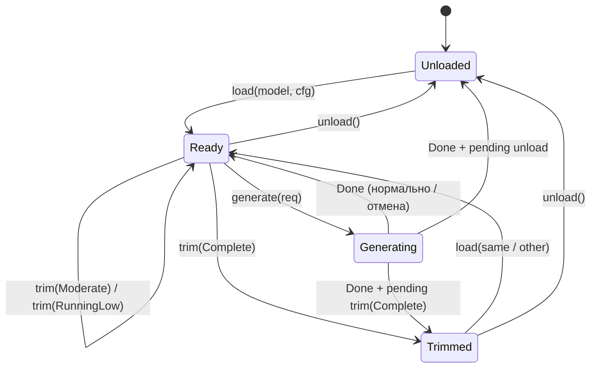

# Контракт движка `sllm-engine` — 2026-11-10

Статус: реализовано в `crates/sllm-engine` (contract + `MockEngine`), реальный
llama.cpp ещё не подключён. Документ фиксирует API, состояния, поведение
отмены/trim и то, как JNI-мост будет отдавать токены в WebView.

## 1. Границы

- `sllm-engine` владеет стабильным API: загрузка, генерация, стриминг,
  отмена, trim, статистика.
- Крейт **не знает** про Android, JNI, WebView и `llama_*`. Зависимости:
  `sllm-core` (чистые типы конфига/ошибок) и `serde`.
- `EngineConfig`, `Backend`, `KvType`, `ErrorCode`, `SllmError`
  переиспользуются из `sllm-core`, чтобы не держать две конфигурации.
- `ModelRef` пока живёт в `sllm-engine`; когда `sllm-model` получит настоящий
  реестр, тип переедет туда (или получит `From<&ModelPack>`), сигнатуры
  `Engine` при этом не изменятся.
- UI видит только `EngineEvent`, `GenStats`, `EngineStats` и стабильные
  `E_*` коды. Указателей и структур llama.cpp в UI нет.

## 2. Типы

| Тип | Поля (Rust) | Назначение |
|---|---|---|
| `EngineConfig` | `threads`, `ctx`, `batch`, `kv`, `mmap`, `mlock`, `flash_attn`, `backend`, `gpu_layers`, `expert_cache_mb` | из `sllm-core`; mock валидирует `threads >= 1`, `ctx >= 512`, `batch >= 1` |
| `ModelRef` | `id`, `path`, `name?`, `loras[]`, `mmproj?` | что грузить; `path` — первый шард GGUF |
| `Message` | `role`, `content` | один ход чата |
| `Role` | `system`, `user`, `assistant`, `tool` | роль |
| `SamplerConfig` | `temperature`, `top_p`, `top_k`, `min_p`, `repeat_penalty` | `temperature = 0` — greedy |
| `GenerateRequest` | `messages`, `sampler`, `max_tokens`, `stop[]`, `seed` | один запрос; `seed = -1` — случайный |
| `EngineEvent` | `Started`, `Token`, `Done`, `Error` | поток событий |
| `GenStats` | `prompt_tokens`, `generated_tokens`, `ttft_ms`, `prefill_ms`, `decode_ms`, `tok_per_s`, `seed`, `canceled`, `mock` | измерения одного запроса |
| `TrimLevel` | `none`, `moderate`, `running_low`, `complete` | Android `onTrimMemory` |
| `EngineState` | `unloaded`, `ready`, `generating`, `trimmed` | состояние движка |
| `EngineStats` | `state`, `model_id`, `trim`, `needs_reload`, `requests`, `generated_tokens`, `last`, `mock` | снимок для UI/логов |
| `EngineError` | `code`, `message`, `retryable` | ошибка с машинным кодом |

Проводной формат (serde) для JS/JNI — `camelCase`:
`maxTokens`, `topP`, `repeatPenalty`, `promptTokens`, `generatedTokens`,
`ttftMs`, `prefillMs`, `decodeMs`, `tokPerS`, `modelId`, `needsReload`.
Имена вариантов — `snake_case`
(`event: "started" | "token" | "done" | "error"`).

## 3. Состояния



Инварианты:

1. Одновременно загружена одна модель и выполняется одна генерация.
2. `generate` возможен только в `Ready`; в `Trimmed` нужен повторный `load`.
3. `cancel` не меняет состояние на `Unloaded` и не является ошибкой.
4. `trim(Complete)` освобождает веса, но сохраняет `model_id` и метаданные
   (`needs_reload = true`).
5. `trim(Moderate|RunningLow)` не выгружает веса: движок остаётся `Ready`.
6. `unload` очищает модель и возвращает `Unloaded`.
7. `load` заменяет текущую модель и сбрасывает счётчики (`requests`,
   `generated_tokens`, `last`, `trim`).
8. `trim` и `unload` во время генерации откладываются до её завершения;
   `load` во время генерации возвращает `E_BUSY`.
9. `stats()` можно вызывать из любого потока, в том числе из sink.

## 4. События и статистика

Успешный поток:

```
Started { promptTokens }
Token   { text, id }        // 0..N раз
Done    { stats }           // ровно один раз
```

Отмена:

```
Started -> Token* -> Done { stats.canceled = true }
```

Отмена не приходит как `Error`: UI показывает «Остановлено», уже полученный
текст остаётся в сообщении. `EngineError::canceled()` существует для
бэкендов/вызывающих, которым удобнее error-shape, но `MockEngine` его не
использует.

Ошибка до старта потока:

- `E_BUSY` — только `Err` из `generate`, событий нет;
- `E_CONFIG` / `E_NO_MODEL` — одно событие `Error` и `Err` из `generate`.

Порядок гарантирован: `Started` раньше любого `Token`; `Done`/`Error` —
последнее событие.

`GenStats`:

- `ttft_ms` — от входа в `generate` до первого токена;
- `prefill_ms` — от входа до конца обработки промпта;
- `decode_ms` — от первого токена до конца;
- `tok_per_s` — по фактическому времени mock-потока; при нулевой задержке
  может быть 0 или шумное большое значение;
- `seed` — эхо из запроса;
- `canceled` — остановлено пользователем;
- `mock = true` — числа не с устройства.

**Stop strings.** Движок держит хвост длиной до `max(len(stop)) - 1` символов,
поэтому стоп-строка, разрезанная между токенами, никогда не уходит в sink.
Конкатенация всех `Token.text` — это видимый ответ без стоп-строки. Из-за
удержания хвоста последние токены могут прийти позже; на отмене хвост
сбрасывается, на стоп-строке — отбрасывается.

**`id` токена** в mock — последовательный номер (1, 2, …), не id словаря.
Реальный бэкенд отдаёт настоящий vocab id. UI не должен полагаться на mock id.

## 5. Потокобезопасность и отмена

```rust
pub trait Engine: Send + Sync {
    fn load(&self, model: &ModelRef, config: &EngineConfig) -> Result<(), EngineError>;
    fn generate(&self, request: &GenerateRequest,
                sink: &mut dyn FnMut(EngineEvent)) -> Result<GenStats, EngineError>;
    fn cancel(&self);
    fn trim(&self, level: TrimLevel);
    fn stats(&self) -> EngineStats;
    fn unload(&self);
}
```

Все методы принимают `&self` намеренно:

- JNI держит `Arc<dyn Engine>`; worker-поток вызывает `generate`, UI-поток —
  `cancel`. С `&mut self` отмена ждала бы мьютекс генерации и была бы
  бесполезной.
- `MockEngine`: `Mutex<MockState>` для состояния, `AtomicBool` для `busy`,
  `Arc<AtomicBool>` для `cancel`. Мьютекс не держится во время стриминга,
  поэтому sink может вызвать `stats`, `trim` или `unload`.
- `cancel()` ставит флаг только если генерация активна; флаг сбрасывается в
  начале следующего `generate`. Вызов `cancel` в простое — no-op.
- Флаг проверяется перед каждым токеном и внутри задержки (шаг 5 мс), поэтому
  отмена из другого потока срабатывает быстро.
- Вложенный `generate` из sink возвращает `E_BUSY` (без deadlock).
- Паникующий sink не оставляет движок в `Generating`: guard восстанавливает
  состояние, `busy` сбрасывается.

## 6. Пример вызова

```rust
use std::sync::Arc;
use std::time::Duration;
use sllm_engine::*;

fn main() -> Result<(), EngineError> {
    let engine: Arc<dyn Engine> = Arc::new(
        MockEngine::new()
            .with_script("Hello from the mock engine.")
            .with_delay(Duration::from_millis(20)),
    );

    engine.load(
        &ModelRef::new("qwen2.5-0.5b", "models/qwen2.5-0.5b-q4_k_m.gguf")
            .with_name("Qwen2.5 0.5B"),
        &EngineConfig { threads: 4, ctx: 4096, ..EngineConfig::default() },
    )?;

    let request = GenerateRequest {
        messages: vec![
            Message::system("You are concise."),
            Message::user("Say hello."),
        ],
        sampler: SamplerConfig { temperature: 0.0, ..SamplerConfig::default() },
        max_tokens: 64,
        stop: vec!["</s>".into()],
        seed: 42,
    };

    let stats = engine.generate(&request, &mut |event| match event {
        EngineEvent::Started { prompt_tokens } => {
            println!("prompt: {prompt_tokens} tokens");
        }
        EngineEvent::Token { text, .. } => print!("{text}"),
        EngineEvent::Done { stats } => {
            println!(
                "\n{} tok, {:.1} tok/s, ttft {} ms, mock={}",
                stats.generated_tokens, stats.tok_per_s, stats.ttft_ms, stats.mock
            );
        }
        EngineEvent::Error { code, message, retryable } => {
            eprintln!("{code}: {message} (retryable={retryable})");
        }
    })?;

    assert!(stats.mock);
    engine.trim(TrimLevel::Complete);
    assert_eq!(engine.stats().state, EngineState::Trimmed);
    engine.load(&ModelRef::new("qwen", "models/qwen.gguf"), &EngineConfig::default())?;
    Ok(())
}
```

Отмена из другого потока:

```rust
let engine: Arc<dyn Engine> = Arc::new(MockEngine::new());
// ... load ...
let worker = {
    let engine = engine.clone();
    std::thread::spawn(move || {
        engine.generate(&request, &mut |event| { /* отправить в UI */ })
    })
};
std::thread::sleep(std::time::Duration::from_millis(100));
engine.cancel();
let stats = worker.join().unwrap()?;
assert!(stats.canceled || stats.generated_tokens > 0);
```

## 7. JNI-мост и WebView

Сейчас в `MainActivity` есть `Sllm.loadModels()` / `Sllm.models()`, а
`nativeModels` возвращает JSON. Генерация добавляется по той же схеме, но
события идут потоком.

### 7.1. Java API

```java
public interface SllmEventSink {
    void onEvent(String json); // вызывается на worker-потоке
}

public static native String nativeEngineLoad(String modelJson, String configJson);
public static native String nativeEngineStats();
public static native void   nativeEngineTrim(int level);   // 5/10/15/80
public static native void   nativeEngineUnload();
public static native void   nativeEngineCancel();
public static native String nativeGenerate(long generationId,
                                           String requestJson,
                                           SllmEventSink sink);
```

В `Bridge` (объект `Sllm`, уже подключённый к WebView):

```java
private final AtomicLong nextGeneration = new AtomicLong(1);

@JavascriptInterface
public void generate(String requestJson) {
    long generationId = nextGeneration.getAndIncrement();
    new Thread(() -> {
        nativeGenerate(generationId, requestJson, eventJson -> {
            runOnUiThread(() -> {
                if (web == null) return;
                String code = "window.sllmToken(" + eventJson + ");";
                web.evaluateJavascript(code, null);
            });
        });
    }, "sllm-generate").start();
}

@JavascriptInterface
public void cancelGeneration() {
    nativeEngineCancel(); // атомарный флаг, UI-поток не блокируется
}
```

`nativeGenerate` синхронно вызывает `sink.onEvent(json)` на каждом
`EngineEvent`, а в конце возвращает итоговый JSON. `sink` не должен блокировать
worker: Java только постит в UI-поток.

### 7.2. Rust-сторона

```rust
static ENGINE: OnceLock<Arc<dyn Engine>> = OnceLock::new();

fn engine() -> &'static Arc<dyn Engine> {
    ENGINE.get_or_init(|| Arc::new(MockEngine::new())) // позже LlamaEngine
}

#[unsafe(no_mangle)]
pub extern "system" fn Java_dev_snapdragonllm_MainActivity_nativeGenerate(
    mut env: JNIEnv,
    _class: JClass,
    generation_id: jlong,
    request_json: JString,
    sink: JObject,
) -> jstring {
    // 1. request_json -> GenerateRequest (serde_json)
    // 2. engine().generate(&request, &mut |event| {
    //        let mut value = serde_json::to_value(&event).unwrap();
    //        value["generationId"] = json!(generation_id);
    //        let text = env.new_string(value.to_string()).unwrap();
    //        env.call_method(&sink, "onEvent", "(Ljava/lang/String;)V",
    //                        &[JValue::Object(&text)]).unwrap();
    //    })
    // 3. вернуть {"ok":true,"stats":{...}} или {"ok":false,"error":{...}}
}
```

Важно: `generate` блокирует worker-поток, а не UI. `cancel` и `stats` можно
вызывать с UI-потока. `nativeEngineLoad` тоже уходит на worker: загрузка
весов/`mmap` занимает секунды.

Ошибки:

- `E_BUSY`, `E_NO_MODEL`, `E_CONFIG` — вернуть `{"ok":false,"error":{...}}`;
  `E_BUSY`/`E_NO_MODEL`/`E_CONFIG` также приходят как одно событие `error`,
  если генерация уже принята.
- `E_IO`/`E_LOAD` — карточка модели + «Details», не тост.
- `E_CANCELED` в mock не используется; отмена — `done.canceled = true`.

### 7.3. События в JS

Рекомендуемая форма (camelCase, `generationId` добавляет Rust/JNI):

```js
window.sllmToken({
  generationId: 7,
  event: "token",
  id: 12,
  text: "Hello"
});
```

Полный набор:

```js
// started
{ generationId, event: "started", promptTokens: 128 }

// token (0..N)
{ generationId, event: "token", id: 12, text: "Hello" }

// done
{
  generationId,
  event: "done",
  stats: {
    promptTokens, generatedTokens,
    ttftMs, prefillMs, decodeMs, tokPerS,
    seed, canceled, mock
  }
}

// error
{ generationId, event: "error", code: "E_LOAD", message: "...", retryable: true }
```

JS-обёртка в `web/src/native.ts`:

```ts
window.sllmToken = (event) => {
  if (event.event === "token") appendToAssistant(event.generationId, event.text);
  else if (event.event === "started") markStreaming(event.generationId, event.promptTokens);
  else if (event.event === "done") finishAssistant(event.generationId, event.stats);
  else if (event.event === "error") failAssistant(event.generationId, event);
};
```

Дросселирование: `evaluateJavascript` на каждый токен дешёв на 20–50 tok/s, но
плох на 500+. Java может копить токены 16–33 мс или 32–64 символа и отправлять
пачкой, сохраняя порядок. `started`/`done`/`error` и первый токен отправлять
сразу; перед `done`/`error` сбрасывать буфер.

### 7.4. Поля, нужные UI

| Поле | Где | Зачем |
|---|---|---|
| `generationId` | все события | отбросить события старой генерации после «New chat»/повторной отправки |
| `event` | все | маршрутизация |
| `text` | token | аккуратно дописать в assistant-сообщение; не пересобирать весь текст |
| `id` | token | диагностика; в mock не словарный id |
| `promptTokens` | started | заполненность контекста, счётчик |
| `generatedTokens` | done/stats | длина ответа, метрика |
| `ttftMs` | done/stats | строка статуса «TTFT» |
| `prefillMs` | done/stats | диагностика скорости prefill |
| `decodeMs` | done/stats | диагностика decode |
| `tokPerS` | done/stats | статус; при `mock = true` подписать «mock» |
| `seed` | done/stats | воспроизводимость в Details |
| `canceled` | done/stats | показать «Остановлено», не ошибку |
| `mock` | done/stats + `EngineStats` | бейдж «mock», запрет сравнивать с device-таблицами |
| `code`, `message`, `retryable` | error | inline-ошибка + кнопка Retry |
| `state`, `modelId`, `trim`, `needsReload` | `Sllm.stats()` | карточка модели, Settings, предупреждение «нужен reload» |
| `requests`, `generatedTokens`, `last` | `Sllm.stats()` | debug/диагностика |

Существующая строка `19.2 tok/s · 3.8 s TTFT` в `web/src/app.tsx` заменяется
на значения из `done.stats`; если `stats.mock`, добавляется `· mock`.

### 7.5. onTrimMemory / unload

Java `onTrimMemory(int level)`:

```
level >= 80 (COMPLETE)          -> nativeEngineTrim(80)  // TrimLevel::Complete
level >= 10 (RUNNING_LOW/CRITICAL) -> nativeEngineTrim(10)
level >= 5  (RUNNING_MODERATE)  -> nativeEngineTrim(5)
```

На `onDestroy`: `nativeEngineCancel()`, затем `nativeEngineUnload()`.
`trim`/`unload` во время генерации не рвут декодер: движок откладывает их до
`Done`; UI увидит `trimmed`/`unloaded` в следующем `stats()`.

## 8. Mock: что он делает и чего не делает

- Стримит заранее заданный текст, разбитый на слова/пробелы; конкатенация
  равна исходной строке.
- Задержка на токен настраивается (`with_delay`), в тестах — `Duration::ZERO`.
- `cancel`, `trim`, `unload`, повторный `load`, `stop`-строки, `max_tokens`,
  `E_BUSY`, `E_NO_MODEL`, `E_CONFIG` покрыты тестами.
- Не открывает файл модели, не считает токены реальным токенизатором
  (`prompt_tokens` — оценка по словам), не претендует на реальные tok/s.
- Все `GenStats`/`EngineStats` имеют `mock: true`. Числа — фактическое время
  mock-потока, а не замер устройства.

## 9. Следующий шаг: `sllm-llama-sys`

1. Крейт `sllm-llama-sys`: bindgen + C++ shim + CMake вокруг
   `external/llama-clover-src` (pinned 4838ffb), экспорт `llama_*`,
   `common_chat_templates`, sampler, LoRA, mmproj (позже).
2. `LlamaEngine` реализует тот же `Engine` (feature `llama`, чтобы host-тесты
   не тянули C++):
   - `load`: `llama_model_load_from_file` (mmap, split), context, KV
     (`q8_0`/`q4_0`), persistent threadpool, LoRA adapters; ошибки →
     `EngineError`/`sllm_core::ErrorCode`;
   - `generate`: chat template → tokenize → prefill батчами → sampler chain
     → цикл `llama_decode`; `Started`, `Token`, `Done`; проверка
     `cancel` перед каждым токеном; те же stop-строки и `max_tokens`;
     `GenStats` с реальными `ttft/prefill/decode/tok_per_s`, `mock = false`,
     `seed` из запроса;
   - `cancel`: atomic, плюс будим threadpool, если он спит;
   - `trim`: Moderate — scratch/картинки; RunningLow — KV/RS; Complete —
     выгрузить веса, оставить `ModelRef` и preflight;
   - `stats`: реальные счётчики, `mock = false`;
   - `unload`: освободить контекст/модель.
3. Тесты: golden output против `llama-cli` (temp=0, seed=42, 64 токена),
   отмена на 1-м токене, trim(Complete) + reload, 100 циклов load/unload без
   роста RSS, повторный load.
4. JNI: подменить фабрику `MockEngine` → `LlamaEngine`; JSON-форма событий и
   поля UI не меняются. `E_QUANT_UNSUPPORTED`/`E_ARCH_UNSUPPORTED` приходят
   из preflight `sllm-core` до загрузки весов.
5. Device gates: Qwen 0.5B ≥ 25 tok/s на MI 8, ≥ 40 на Pad 2; Bonsai;
   Clover; TTFT, PSS, 30-мин soak. До этого `mock: true` нигде не сравнивать
   с этими числами.

## 10. Открытые вопросы

- Перенос `ModelRef` в `sllm-model` и `From<&ModelPack>`.
- `min_p`/`repeat_penalty` и порядок sampler-цепочки фиксируются в
  `sllm-llama-sys`; контракт уже содержит поля.
- Батчинг токенов в JNI: отправлять каждый или копить 16–33 мс. Решение
  оставить за WebView-слоем, движок всегда отдаёт по токену.
- `EngineConfig` из `sllm-core` сериализуется `snake_case`
  (`gpu_layers`, `flash_attn`); если настройки когда-нибудь пойдут из JS,
  понадобится DTO в `sllm-webapp`.
